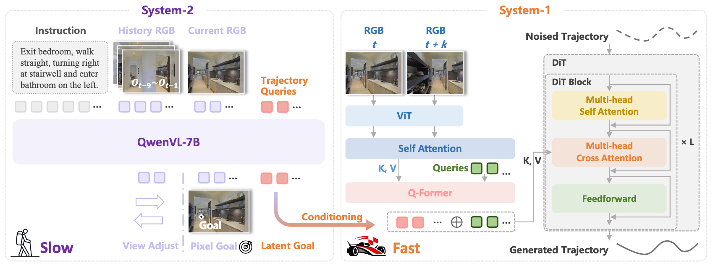
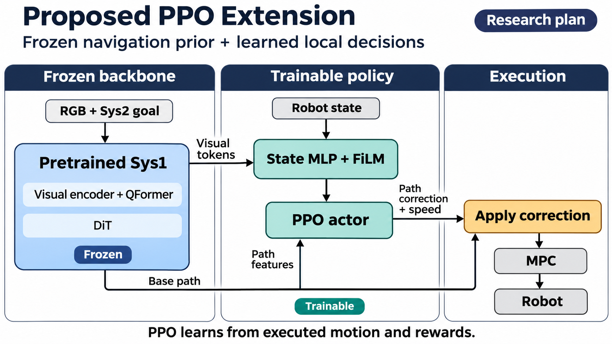

# InternNav-RL

Research fork of [InternRobotics/InternNav](https://github.com/InternRobotics/InternNav), investigating reinforcement learning for dynamic obstacle avoidance in DualVLN / InternVLA-N1.

**Status: research planning; the RL extension is not implemented yet.** The architecture below is a proposed baseline, not a released feature. This fork does not currently provide a PPO trainer, dynamic-obstacle training environment, RL checkpoints, or experimental results for the proposed method. Existing upstream capabilities are documented separately below.

The initial direction is **PPO with a learned local decision policy built on a frozen pretrained Sys1**. FPO and joint training of the original DiT are future research directions. The objective is to reduce reliance on additional expert demonstrations; online RL still requires simulator interactions and reward feedback.

## Research navigation

- [Research objective](#research-objective)
- [Proposed PPO baseline](#proposed-ppo-baseline)
- [Training and execution](#training-and-execution)
- [Evaluation plan](#evaluation-plan)
- [Roadmap](#roadmap)
- [Development and code map](#development-and-code-map)
- [Attribution and licensing](#attribution-and-licensing)
- [Upstream InternNav documentation](#upstream-internnav-documentation)

## Research objective

Improve navigation around moving obstacles, especially pedestrians, while preserving instruction following and the latency advantages of the dual-system architecture. Desired behaviors include local detours, slowing down, yielding, waiting, and resuming progress after an encounter.

The research will examine whether a small policy can use existing visual representations, a pretrained reference path, and robot motion information to improve these decisions. Safety, task completion, interaction cost, and inference latency must be evaluated together. No performance improvement or real-time guarantee has been established for this fork.

## Proposed PPO baseline

The first baseline keeps the pretrained navigation backbone frozen and learns an additional local policy using Proximal Policy Optimization (PPO).

### Original DualVLN architecture



*Original architecture from [DualVLN](https://arxiv.org/abs/2512.08186), preserved from the user-provided figure without modification. This figure describes the upstream model and does not include the proposed PPO extension.*

### Proposed PPO extension



*Conceptual illustration generated with ChatGPT Image for this fork; it depicts planned components, not an implemented system. The [generation prompt](assets/diagrams/ppo-baseline.prompt.txt) is included for reference.*

The base path is supplied both to the PPO actor as a feature and to the execution stage as the reference to be corrected. Fused visual/state features feed the actor, not the frozen DiT. The critic and training updates are omitted for clarity.

This diagram describes the planned continuous execution baseline. The existing Habitat discrete-action pipeline is a separate execution path; the training interface must be established before this architecture can be evaluated there.

### State encoding and feature fusion

Candidate state inputs include measured linear/angular velocity, the previous issued control command, and the time interval between observations. Inputs must be normalized, expressed in consistent units and frames, and aligned with the visual observation timestamp. Measured motion and commanded motion are distinct signals.

A small MLP will encode these numerical inputs. No separately pretrained state embedding model is required. The initial fusion candidate is **FiLM**: the MLP predicts channel-wise scale and bias for the QFormer outputs. For visual token `Q_i`, the proposed residual form is:

```text
gamma, beta = StateMLP(normalized_robot_state)
Q_fused[i] = (1 + gamma) * Q[i] + beta
```

The same channel parameters are broadcast across the 32 tokens. Zero-initializing the final modulation layer makes this transformation initially preserve the original features. Token count and feature dimension remain unchanged; the additional encoding and modulation still have a latency cost that must be measured.

The 32 QFormer visual tokens are **not** the 32 predicted trajectory increments and do not have a one-to-one correspondence with them. Robot motion inputs also do not, by themselves, reveal pedestrian velocity. Whether the existing visual observations contain sufficient motion information remains an open question.

FiLM is a baseline to test, not an assumed best solution. Simple concatenation, additive fusion, gating, and other fusion methods will be compared without automatically increasing the attention sequence length.

### Policy, actions, and trainable modules

The PPO actor will fuse visual, state, and base-path features and output a tractable stochastic action distribution. A small MLP actor with Gaussian parameters is an initial candidate; the bounded action mapping and log-probability calculation must be defined consistently. Training samples actions for exploration; evaluation will document the chosen deterministic or stochastic rule.

The candidate action space is **near-term path corrections plus a speed adjustment**. The number of corrected points, correction bounds, speed parameterization, and policy update interval are not finalized. Corrections must cover the reference region actually used by the controller rather than assuming only the first path point matters.

| Component | Initial training scope |
| --- | --- |
| Sys2 and goal-latent extraction | Frozen |
| Sys1 visual encoder and QFormer | Frozen |
| Original trajectory DiT and its existing projections | Frozen |
| State encoder and feature-fusion module | Trainable |
| PPO actor and critic | Trainable |
| MPC | Fixed optimization algorithm; adapt its interface to accept policy outputs |

The critic estimates future return from the rollout data. Actor inputs must be available at deployment; any simulator-only information used for rewards or the critic must be identified explicitly.

In this baseline, fused features feed the **new PPO actor**, while the original DiT retains its original conditioning and supplies the base path. Gradients stop at the frozen backbone outputs, so training does not require backpropagation through DiT sampling. This improves the execution chain through a learned policy; it does not fine-tune the original DiT weights. Feeding modulated features back into DiT would be a different design and would still require a suitable policy-probability formulation for PPO.

## Training and execution

The planned rollout loop is:

1. Obtain the current observation, synchronized robot state, Sys2 condition, and DiT base path.
2. Sample a correction and speed action from the PPO actor.
3. Apply the action through the controller for a defined short simulation interval.
4. Record the sampled action, its log probability, actual controls, elapsed time, rewards, and next observation.
5. Continue the encounter or navigation episode and use its returns to train the actor, fusion modules, and critic.

Replanning is a transition within an episode, not an episode termination. A long reference path may be generated while only a short motion interval is executed. Later reference points can still influence MPC's first control command. Rewards should reflect actual execution and subsequent outcomes, rather than treating the entire predicted path as executed.

Reward design will balance task progress and success against human/static collisions, near-collision risk, elapsed time, and abrupt changes in executed controls. Waiting must advance simulation time and remain distinct from terminating the navigation task. A collision-only objective can reward permanent stopping; excessive progress or time pressure can discourage necessary yielding. Reward definitions and weights are not finalized.

The existing real-world MPC and Habitat action conversion are not interchangeable. Continuous speed control requires an appropriate simulator action interface. The existing MPC also needs explicit support for policy-controlled speed parameters; changing a Python attribute alone does not update its initialized optimization constraints.

## Evaluation plan

Start with repeatable local encounters such as a pedestrian crossing, an approaching pedestrian, and a narrow-passage interaction. Then evaluate complete instruction-following navigation. The dynamic simulator, collision measurements, and rollout interface are prerequisites, not currently supplied by this research extension.

Initial comparisons should include:

| Experiment | Purpose |
| --- | --- |
| Pretrained system without the added policy | Establish the inherited baseline |
| Same execution/sampling changes, without RL | Isolate changes caused by the execution interface |
| Frozen backbone + PPO with simple feature concatenation | Establish a basic learned-fusion baseline |
| Frozen backbone + PPO with FiLM | Test modulation under the same observations and action space |

The upstream trajectory postprocessor averages candidate paths. Any change to this behavior must be documented and evaluated separately. When defining RL actions, record the actual sampled policy action and its execution mapping; an averaged path must not be treated as one original trajectory sample.

Report navigation success, human and static collision rates, completion time, path efficiency, motion smoothness, and static-navigation regression. Also report environment interactions, training wall-clock time, and end-to-end observation-to-control latency, including tail latency. Upstream model throughput is not a measured latency result for this extension.

Use separate training and held-out scenes and pedestrian behaviors, multiple seeds, and comparable interaction/compute budgets. Record the upstream revision, checkpoint, dependencies, simulator version, control and policy intervals, action bounds, reward configuration, and evaluation protocol. Simulation time must advance consistently rather than depend on inference wall-clock duration.

## Roadmap

All items below are planned work; unchecked items are not implemented features.

- [ ] Establish a reproducible pretrained baseline and profile end-to-end latency.
- [ ] Build a dynamic-obstacle simulation and rollout interface with collision feedback.
- [ ] Define the action space, controller interface, state synchronization, and reward specification.
- [ ] Implement the state encoder, concatenation baseline, PPO actor, and critic.
- [ ] Implement FiLM fusion and compare it with the concatenation baseline.
- [ ] Evaluate local encounters, full navigation, and static-task retention.
- [ ] Explore additive/gated modulation and fusion methods beyond modulation.
- [ ] Explore unfreezing DiT or other backbone modules, with an explicit PPO gradient/probability formulation and training-cost analysis.
- [ ] Investigate FPO or other RL algorithms for a suitably parameterized policy. FPO targets flow-based policies and is not a drop-in loss replacement for the Gaussian PPO actor.

## Development and code map

For the inherited installation, data preparation, checkpoints, and evaluation workflows, follow the [upstream getting-started documentation](https://internrobotics.github.io/user_guide/internnav/quick_start/index.html). There is no research-specific training command yet; verified commands and environment requirements will be added with the implementation.

Relevant existing code:

| Area | Location |
| --- | --- |
| Visual memory encoder, QFormer, and Sys1 projections | [`internvla_n1_arch.py`](internnav/model/basemodel/internvla_n1/internvla_n1_arch.py) |
| Flow Matching loss and trajectory sampling | [`internvla_n1.py`](internnav/model/basemodel/internvla_n1/internvla_n1.py) |
| Sys1 policy and action conversion entry point | [`internvla_n1_policy.py`](internnav/model/basemodel/internvla_n1/internvla_n1_policy.py) |
| Trajectory reconstruction and candidate averaging | [`vln_utils.py`](internnav/model/utils/vln_utils.py) |
| Real-world planning and control threads | [`http_internvla_client.py`](scripts/realworld/http_internvla_client.py) |
| MPC implementation | [`controllers.py`](scripts/realworld/controllers.py) |
| Habitat VLN evaluation | [`habitat_vln_evaluator.py`](internnav/habitat_extensions/vln/habitat_vln_evaluator.py) |

Research discussions, reproducible bug reports, and proposed changes for this fork belong in [this fork's issues](https://github.com/yAnaM1-AnNaa/InternNav-RL/issues) and pull requests. Clearly distinguish proposed methods from implemented behavior and attach experimental settings to reported results.

## Attribution and licensing

This is an independent research fork, not an official InternRobotics release. The original toolbox, pretrained models, upstream demonstrations, and benchmark results are credited to their respective authors. Cite the original work using the [upstream citation entries](#-citation); this fork does not yet have a separate research publication.

The code is covered by the existing [MIT License](LICENSE); retain the original copyright and permission notice. Dataset, model-weight, and third-party component licenses must be checked separately. The inherited data-license information is retained in the [upstream license section](#-license).

Method references:

- [DualVLN: Ground Slow, Move Fast](https://arxiv.org/abs/2512.08186)
- [Proximal Policy Optimization Algorithms](https://arxiv.org/abs/1707.06347)
- [FiLM: Visual Reasoning with a General Conditioning Layer](https://arxiv.org/abs/1709.07871)
- [Flow Matching Policy Gradients](https://arxiv.org/abs/2507.21053) — future investigation

## Upstream InternNav documentation

The documentation below is inherited from [InternRobotics/InternNav](https://github.com/InternRobotics/InternNav). Its news, model downloads, demonstrations, benchmark tables, and community links describe the upstream project, not results or releases of the planned RL extension. References to "we" and "our" in this section refer to the upstream authors.

<div align="center">

[](https://www.youtube.com/watch?v=fD0F1jIax5Y)

[](https://internrobotics.github.io/internvla-n1.github.io/)
[](https://internrobotics.github.io/internvla-n1.github.io/static/pdfs/InternVLA_N1.pdf)
[](https://arxiv.org/abs/2512.08186)
[](https://internrobotics.github.io/user_guide/internnav/index.html)
[](https://github.com/InternRobotics/InternNav)
[](https://github.com/InternRobotics/InternNav/issues)
<a href="https://cdn.vansin.top/taoyuan.jpg"></a>
[](https://discord.gg/5jeaQHUj4B)

</div>

## 🏠 Introduction

InternNav is an All-in-one open-source toolbox for embodied navigation based on PyTorch, Habitat and Isaac Sim.

### Highlights
- Modular Support of the Entire Navigation System

We support modular customization and study of the entire navigation system, including vision-language navigation with discrete action space (VLN-CE), visual navigation (VN) given point/image/trajectory goals, and the whole VLN system with continuous trajectory outputs.

- Compatibility with Mainstream Simulation Platforms

The toolbox is compatible with different training and evaluation requirements, supporting different environments for the usage of mainstream simulation platforms such as Habitat and Isaac Sim.

- Comprehensive Datasets, Models and Benchmarks

The toolbox supports the most comprehensive 6 datasets \& benchmarks and 10+ popular baselines, including both mainstream and our established brand new ones.

- State of the Art

The toolbox supports the most advanced high-quality navigation dataset, InternData-N1, which includes 3k+ scenes and 830k VLN data covering diverse embodiments and scenes, and the first dual-system navigation foundation model with leading performance on all the benchmarks and zero-shot generalization capability in the real world, InternVLA-N1.

## 🔥 News
| Time   | Update |
|---------|--------|
| 2026/01 | InternNav v0.3.0 released. |
| 2025/12 | We introduce Interactive Instance Goal Navigation (IIGN) and release VL-LN Bench to enable InternVLA-N1 to solve this task, with large-scale dialog-trajectory collection plus training and evaluation support. See [our website](https://0309hws.github.io/VL-LN.github.io/) for details.|
| 2025/12 | Training code for InternVLA-N1 and the corresponding [usage doc](https://internrobotics.github.io/user_guide/internnav/quick_start/training.html) is now available. This release provides two model configurations: InternVLA-N1 (Dual System)<span style="color: #28a745; font-size: 0.9em"> with NavDP*</span> and InternVLA-N1 (Dual System)<span style="color: #28a745; font-size: 0.9em"> DualVLN </span>. For model architecture and training details, please refer to the [DualVLN paper](https://arxiv.org/abs/2512.08186).|
| 2025/11 | InternNav v0.2.0 released — added distributed evaluation support for VLN-PE.|
| 2025/10 | Add a [inference-only demo](scripts/notebooks/inference_only_demo.ipynb) of InternVLA-N1. |
| 2025/10 | InternVLA-N1 [technical report](https://internrobotics.github.io/internvla-n1.github.io/static/pdfs/InternVLA_N1.pdf) is released. Please check our [homepage](https://internrobotics.github.io/internvla-n1.github.io/). |
| 2025/09 | Real-world deployment code of InternVLA-N1 released. Upload 3D printing [files](assets/3d_printing_files/go2_stand.STEP) for Unitree Go2. |
| 2025/07 | Hosting the 🏆 IROS 2025 Grand Challenge (see updates at [official website](https://internrobotics.shlab.org.cn/challenge/2025/)) |
| 2025/07 | InternNav v0.1.1 released |

## 📋 Table of Contents
- [🏠 Introduction](#-introduction)
- [🔥 News](#-news)
- [📚 Getting Started](#-getting-started)
- [📦 Overview of Benchmark \& Model Zoo](#-overview)
- [🔧 Customization](#-customization)
- [👥 Contribute](#-contribute)
- [🚀 Community Deployment & Best Practices](#-community-deployment--best-practices)
- [🔗 Citation](#-citation)
- [📄 License](#-license)
- [👏 Acknowledgements](#-acknowledgements)

## 📚 Getting Started

Please refer to the [documentation](https://internrobotics.github.io/user_guide/internnav/quick_start/index.html) for quick start with InternNav, from installation to training or evaluating supported models.

## 📦 Overview

### 🧪 Supported Benchmarks

<table align="center">
  <tbody>
    <tr align="center" valign="bottom">
      <td>
         <b>VLN Benchmarks</b>
      </td>
      <td>
         <b>VN Benchmarks</b>
      </td>
   </tr>
   <tr align="center" valign="top">
      <td>
         <ul>
            <li align="left"><a href="https://arxiv.org/abs/2004.02857">VLN-CE</a></li>
            <li align="left"><a href="https://arxiv.org/abs/2507.13019">VLN-PE</a></li>
         </ul>
      </td>
      <td>
         <ul>
            <li align="left"><a href="https://arxiv.org/abs/2505.08712">Cluttered Environments</a></li>
            <li align="left"><a href="https://arxiv.org/abs/2505.08712">GRScenes-100</a></li>
         </ul>
      </td>
   </tbody>
</table>

### 🤗 Model Zoo & Downloads

<table align="center">
  <tbody>
    <tr align="center" valign="bottom">
      <td>
         <b>🧠 VLN Single-System</b>
      </td>
      <td>
         <b>🎯 VN System (System1)</b>
      </td>
      <td>
         <b>🤝 VLN Multi-System</b>
      </td>
   </tr>
   <tr align="center" valign="top">
      <td>
         <ul>
            <li align="left"><a href="https://huggingface.co/InternRobotics/VLN-PE">Seq2Seq</a></li>
            <li align="left"><a href="https://huggingface.co/InternRobotics/VLN-PE">CMA</a></li>
            <li align="left"><a href="https://huggingface.co/InternRobotics/VLN-PE">RDP</a></li>
            <li align="left"><a href="https://github.com/InternRobotics/StreamVLN">StreamVLN</a> <em>(coming soon)</em></li>
         </ul>
      </td>
      <td>
         <ul>
            <li align="left"><a href="https://github.com/InternRobotics/NavDP?tab=readme-ov-file#%EF%B8%8F-installation-of-baseline-library">DD-PPO</a></li>
            <li align="left"><a href="https://github.com/InternRobotics/NavDP?tab=readme-ov-file#%EF%B8%8F-installation-of-baseline-library">iPlanner</a></li>
            <li align="left"><a href="https://github.com/InternRobotics/NavDP?tab=readme-ov-file#%EF%B8%8F-installation-of-baseline-library">ViPlanner</a></li>
            <li align="left"><a href="https://github.com/InternRobotics/NavDP?tab=readme-ov-file#%EF%B8%8F-installation-of-baseline-library">GNM</a></li>
            <li align="left"><a href="https://github.com/InternRobotics/NavDP?tab=readme-ov-file#%EF%B8%8F-installation-of-baseline-library">ViNT</a></li>
            <li align="left"><a href="https://github.com/InternRobotics/NavDP?tab=readme-ov-file#%EF%B8%8F-installation-of-baseline-library">NoMad</a></li>
            <li align="left"><a href="https://github.com/InternRobotics/NavDP?tab=readme-ov-file#%EF%B8%8F-installation-of-baseline-library">NavDP <small>InternVLA-N1 (System 1)</small></a></li>
         </ul>
      </td>
      <td>
         <ul>
            <li align="left"><a href="https://huggingface.co/InternRobotics/InternVLA-N1-System2">InternVLA-N1 (System 2)</a> + <a href="https://github.com/InternRobotics/NavDP?tab=readme-ov-file#%EF%B8%8F-installation-of-baseline-library" style="color: #1e90ff;">Decoupled System1</a></li>
            <li align="left"><a href="https://huggingface.co/InternRobotics/InternVLA-N1-w-NavDP">InternVLA-N1 (Dual System) <small>w/ NavDP*</small> </a>  <small> (NavDP*</small> indicates joint tuning with System 2)</li>
            <li align="left"><a href="https://huggingface.co/InternRobotics/InternVLA-N1-DualVLN">InternVLA-N1 (Dual System) <small>DualVLN</small></a></li>
         </ul>
      </td>
   </tbody>
</table>

<!-- **📝 Note:**
- VLN-CE RxR benchmark and StreamVLN model will be supported soon.
- **NE**: Navigation Error (lower is better) • **OS**: Oracle Success (higher is better) • **SR**: Success Rate (higher is better) • **SPL**: Success weighted by Path Length (higher is better) -->


### 📊 Benchmark Results


#### <u>VLN-CE Benchmarks</u>

**📍 R2R Dataset**
| Model | Observation | NE ↓ | OS ↑ | SR ↑ | SPL ↑ |
|-------|-------------|------|------|------|-------|
| InternVLA-N1-wo-dagger (S2) + [ShortestPathFollower](https://aihabitat.org/docs/habitat-lab/habitat.tasks.nav.shortest_path_follower.ShortestPathFollower.html) | - | 4.89 | 60.6 | 55.4 | 52.1 |
| InternVLA-N1-wo-dagger (Dual System) <span style="color: #28a745; font-size: 0.9em"> with NavDP*</span>  | RGB-D | 4.83 | 63.3 | 58.2 | 54.0 |
| InternVLA-N1 (S2) + [ShortestPathFollower](https://aihabitat.org/docs/habitat-lab/habitat.tasks.nav.shortest_path_follower.ShortestPathFollower.html) | - | 4.25 | 68.3 | 60.9 | 55.2 |
| InternVLA-N1 (Dual System)<span style="color: #28a745; font-size: 0.9em"> with NavDP*</span> | RGB-D | 4.22 | 70.4 | 64.1 | 58.1 |
| InternVLA-N1 (Dual System)<span style="color: #28a745; font-size: 0.9em"> DualVLN </span> | RGB | **4.05** | **70.7** | **64.3** | **58.5** |

**📍 RxR Dataset**
| Model | Observation | NE ↓ |  SR ↑ | SPL ↑ | nDTW ↑ |
|-------|-------------|------|------|------|-------|
| InternVLA-N1 (S2) + [ShortestPathFollower](https://aihabitat.org/docs/habitat-lab/habitat.tasks.nav.shortest_path_follower.ShortestPathFollower.html) | - | 5.71 | 63.5 | 55.0 | 46.8 |
| InternVLA-N1 (Dual System)<span style="color: #28a745; font-size: 0.9em"> with NavDP*</span> | RGB-D | 4.70 | 59.7 | 50.6 | 69.7 |
| InternVLA-N1 (Dual System)<span style="color: #28a745; font-size: 0.9em"> DualVLN </span> | RGB | **4.58** | **61.4** | **51.8** | **70.0** |

#### <u>VLN-PE Benchmarks</u>

**📍 Flash Controller on R2R Unseen**
| Model | NE ↓ | OS ↑ | SR ↑ | SPL ↑ |
|-------|------|------|------|-------|
| Seq2Seq | 8.27 | 43.0 | 15.7 | 9.7 |
| CMA | 7.52 | 45.0 | 24.4 | 18.2 |
| RDP | 6.98 | 42.5 | 24.9 | 17.5 |
| InternVLA-N1 (System 2) + iPlanner | 4.91 | 55.53 | 47.07 | 41.09 |
| InternVLA-N1 (System 2) + NavDP | 4.22 | 67.33 | 58.72 | 50.98 |
| InternVLA-N1 (Dual System)<span style="color: #28a745; font-size: 0.9em"> DualVLN </span> | **3.90** | **69.93** | **63.62** | **56.49** |

**📍 Physical Controller on R2R Unseen**
| Model | NE ↓ | OS ↑ | SR ↑ | SPL ↑ |
|-------|------|------|------|-------|
| Seq2Seq | 7.88 | 28.1 | 15.1 | 10.7 |
| CMA | 7.26 | 31.4 | 22.1 | 18.6 |
| RDP | 6.72 | 36.9 | 25.2 | 17.7 |
| InternVLA-N1 (Dual System)<span style="color: #28a745; font-size: 0.9em"> DualVLN </span> | **4.66** | **55.9** | **51.6** | **42.49** |


#### <u>Visual Navigation Benchmarks</u>

**📍 ClutteredEnv Dataset**
| Model | SR ↑ | SPL ↑ |
|-------|------|-------|
| iPlanner | 84.8 | 83.6 |
| ViPlanner | 72.4 | 72.3 |
| NavDP <InternVLA-N1 (System 1)> | **89.8** | **87.7** |

**📍 InternScenes Dataset**
| Model | SR ↑ | SPL ↑ |
|-------|------|-------|
| iPlanner | 48.8 | 46.7 |
| ViPlanner | 54.3 | 52.5 |
| NavDP <InternVLA-N1 (System 1)> | **65.7** | **60.7** |

## 🔧 Customization

Please refer to the [tutorial](https://internrobotics.github.io/user_guide/internnav/tutorials/index.html) for advanced usage of InternNav, including customization of datasets, models and experimental settings.

## 👥 Contribute

If you would like to contribute to InternNav, please check out our [contribution guide]().
For example, raising issues, fixing bugs in the framework, and adapting or adding new policies and data to the framework.

**Note:** We welcome the feedback of the model's zero-shot performance when deploying in your own environment. Please show us your results and offer us your future demands regarding the model's capability. We will select the most valuable ones and collaborate with users together to solve them in the next few months :)

## 🚀 Community Deployment & Best Practices

We are excited to see InternNav being deployed and extended by the community across different robots and real-world scenarios.
Below are selected community-driven deployment guides and solution write-ups, which may serve as practical references for advanced users.

- **IROS Challenge Nav Track: Champion Solution (2025)**
  A complete system-level solution and design analysis for Vision-and-Language Navigation in Physical Environments.
  🔗 https://zhuanlan.zhihu.com/p/1969046543286907790

- **Go2 Series Deployment Tutorial (ShanghaiTech University)**
  Step-by-step edge deployment guide for InternNav-based perception and navigation.
  🔗 https://github.com/cmjang/InternNav-deploy

- **G1 Series Deployment Tutorial (Wuhan University)**
  Detailed educational materials on vision-language navigation deployment.
  🔗 [*Chapter 5: Vision-Language Navigation (Part II)*](https://mp.weixin.qq.com/s/p3cJzbRvecMajiTh9mXoAw)

## 🔗 Citation

If you find our InternVLA-N1 (Dual System) model helpful, please cite our ICLR paper and previous technical report:
```bibtex
@inproceedings{
  wei2026ground,
  title={Ground Slow, Move Fast: A Dual-System Foundation Model for Generalizable Vision-Language Navigation},
  author={Meng Wei and Chenyang Wan and Jiaqi Peng and Xiqian Yu and Yuqiang Yang and Delin Feng and Wenzhe Cai and Chenming Zhu and Tai Wang and Jiangmiao Pang and Xihui Liu},
  booktitle={The Fourteenth International Conference on Learning Representations},
  year={2026},
  url={https://openreview.net/forum?id=GK4rznYwhn}
}
@misc{internvla-n1,
    title = {{InternVLA-N1: An} Open Dual-System Navigation Foundation Model with Learned Latent Plans},
    author = {InternNav Team},
    year = {2025},
    booktitle={arXiv},
}
```

If you use this InternNav codebase to develop your method, please cite our codebase:
```bibtex
@misc{internnav2025,
    title = {{InternNav: InternRobotics'} open platform for building generalized navigation foundation models},
    author = {InternNav Contributors},
    howpublished={\url{https://github.com/InternRobotics/InternNav}},
    year = {2025}
}
```


<details><summary>If you use the specific pretrained models and benchmarks, please kindly cite the original papers below.</summary>

```BibTex

@inproceedings{vlnpe,
  title={Rethinking the Embodied Gap in Vision-and-Language Navigation: A Holistic Study of Physical and Visual Disparities},
  author={Wang, Liuyi and Xia, Xinyuan and Zhao, Hui and Wang, Hanqing and Wang, Tai and Chen, Yilun and Liu, Chengju and Chen, Qijun and Pang, Jiangmiao},
  booktitle={Proceedings of the IEEE/CVF International Conference on Computer Vision (ICCV)},
  year={2025}
}
@inproceedings{streamvln,
    title = {StreamVLN: Streaming Vision-and-Language Navigation via SlowFast Context Modeling},
    author = {Wei, Meng and Wan, Chenyang and Yu, Xiqian and Wang, Tai and Yang, Yuqiang and Mao, Xiaohan and Zhu, Chenming and Cai, Wenzhe and Wang, Hanqing and Chen, Yilun and Liu, Xihui and Pang, Jiangmiao},
    booktitle={2026 IEEE International Conference on Robotics and Automation (ICRA)},
    year = {2026}
}
@inproceedings{navdp,
    title = {NavDP: Learning Sim-to-Real Navigation Diffusion Policy with Privileged Information Guidance},
    author = {Wenzhe Cai, Jiaqi Peng, Yuqiang Yang, Yujian Zhang, Meng Wei, Hanqing Wang, Yilun Chen, Tai Wang and Jiangmiao Pang},
    booktitle={2026 IEEE International Conference on Robotics and Automation (ICRA)},
    year = {2026},
}
```

</details>


## 📄 License

InternNav's codes are [MIT licensed](LICENSE).
The open-sourced InternData-N1 data are under the <a rel="license" href="http://creativecommons.org/licenses/by-nc-sa/4.0/">Creative Commons Attribution-NonCommercial-ShareAlike 4.0 International License </a><a rel="license" href="http://creativecommons.org/licenses/by-nc-sa/4.0/"></a>.
Other datasets like VLN-CE inherit their own distribution licenses.

## 👏 Acknowledgement

- [InternUtopia](https://github.com/InternRobotics/InternUtopia) (Previously `GRUtopia`): The closed-loop evaluation and GRScenes-100 data in this framework relies on the InternUtopia framework.
- [Diffusion Policy](https://github.com/real-stanford/diffusion_policy): Diffusion policy implementation.
- [LongCLIP](https://github.com/beichenzbc/Long-CLIP): Long-text CLIP model.
- [VLN-CE](https://github.com/jacobkrantz/VLN-CE): Vision-and-Language Navigation in Continuous Environments based on Habitat.
- [Qwen2.5-VL](https://github.com/QwenLM/Qwen2.5-VL): The pretrained vision-language foundation model.
- [LeRobot](https://github.com/huggingface/lerobot): The data format used in this project largely follows the conventions of LeRobot.
